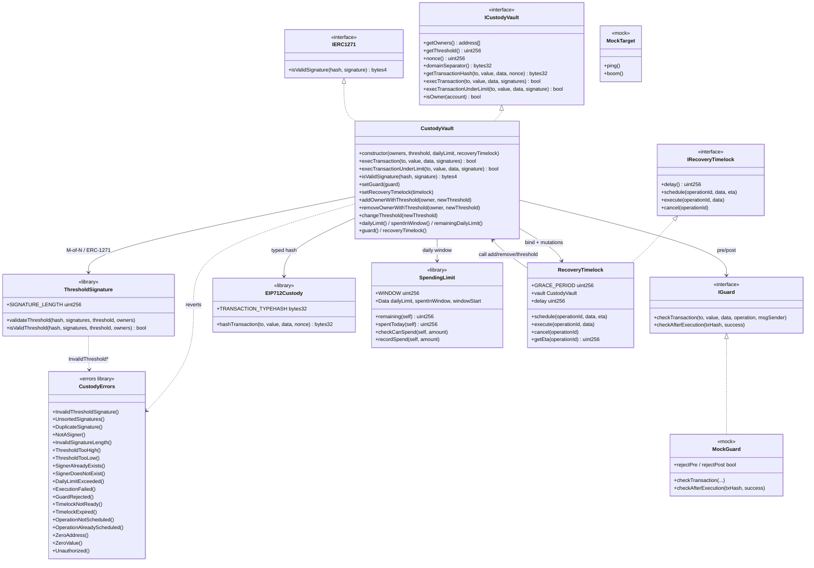

# Class diagram — Institutional Custody, Multisig & MPC Integration

Structural view aligned with the v1 implementation (module 20).  
**Sync:** 2026-09-15 · Phases **BOOT → SOLV** ✅ · `forge test` → **69 PASS**.

> **Reference standard:** Safe-style multisig vault + on-chain Secp256k1 threshold verification, ERC-1271, spending limits and timelocked recovery.  
> "MPC" = off-chain signatures (possibly via MPC) **verified** on-chain as M-of-N ECDSA; there is no MPC circuit in the contract.

## Diagram (Mermaid)



## Responsibilities

| Artifact | Responsibility |
|----------|----------------|
| `CustodyVault` | Owners/threshold/nonce; quorum exec + under-limit; ERC-1271; guard; timelock binding |
| `ThresholdSignature` | In-place ECDSA recover + ascending order + unique owners ≥ M |
| `EIP712Custody` | Typehash `CustodyTransaction(to,value,data,nonce)` |
| `SpendingLimit` | Rolling `1 days` window; `remaining` / `recordSpend` |
| `IGuard` / `MockGuard` | Pre/post policy (lab) |
| `RecoveryTimelock` | Delay + 14d grace; schedule/cancel vault-only; permissionless execute |
| `CustodyErrors` | Module custom errors |
| `MockTarget` | Execution target in tests |

## Runtime permission model

```
  execTransaction(to, value, data, signatures)
           │
           ▼
  ┌────────────────────┐
  │ Threshold M-of-N   │──fail──► InvalidThreshold* / Unsorted / Dup / NotASigner
  └─────────┬──────────┘
            │ ok
            ▼
  ┌────────────────────┐
  │ Guard pre (cached) │──fail──► GuardRejected
  └─────────┬──────────┘
            │ ok / no guard
            ▼
  ┌────────────────────┐
  │ Effects: nonce++   │  (CEI)
  └─────────┬──────────┘
            ▼
  ┌────────────────────┐
  │ to.call{value}     │──fail──► ExecutionFailure + return false
  └─────────┬──────────┘
            │ (success or false)
            ▼
      Guard post (same cached guard)
      Emit Success / Failure
```

> Under-limit: 1 owner signature + `checkCanSpend(value)` + `recordSpend` in effects.  
> Full quorum **bypasses** the daily cap.  
> A failed call does **not** revert the outer tx (nonce/spend already consumed).

## Roles

| Role | Mechanism | Actions |
|------|-----------|---------|
| Owner / Signer | on-chain list | Sign EIP-712; under-limit with 1 signature |
| Relayer | anyone | `execTransaction` / under-limit / `timelock.execute` |
| Guard | `IGuard` via multisig `setGuard` | Reject pre/post |
| Recovery timelock | bound once | Mutate owners/threshold after delay |
| dApp | ERC-1271 | `isValidSignature` |

## Custom errors (implemented)

| Error | Usage |
|-------|-------|
| `InvalidThresholdSignature()` | Invalid threshold / recover |
| `UnsortedSignatures()` / `DuplicateSignature()` | Order / duplicate |
| `NotASigner()` | Recovered address ∉ owners |
| `InvalidSignatureLength()` | Packed ≠ 65·N |
| `DailyLimitExceeded()` | Under-limit without allowance |
| `GuardRejected()` | Guard pre/post fails |
| `TimelockNotReady()` / `TimelockExpired()` | Execute outside the window |
| `OperationNotScheduled()` / `AlreadyScheduled()` | Schedule/cancel/execute |
| `ExecutionFailed()` | Timelock call to the vault failed |
| `Unauthorized()` | Self-call / timelock / data mismatch |
| `ThresholdTooHigh/Low` / `SignerAlreadyExists/DoesNotExist` | Custody mutations |
| `ZeroAddress()` / `ZeroValue()` | Invalid inputs |
