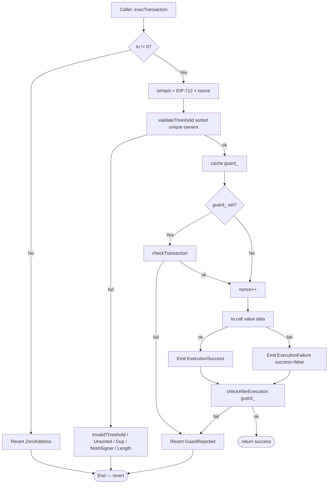
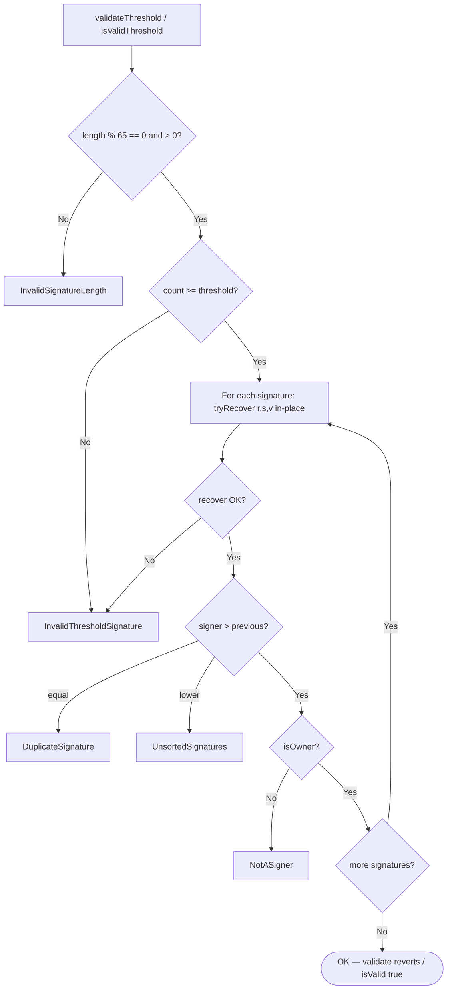
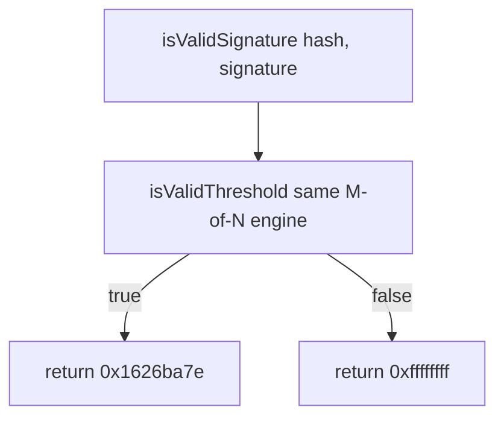
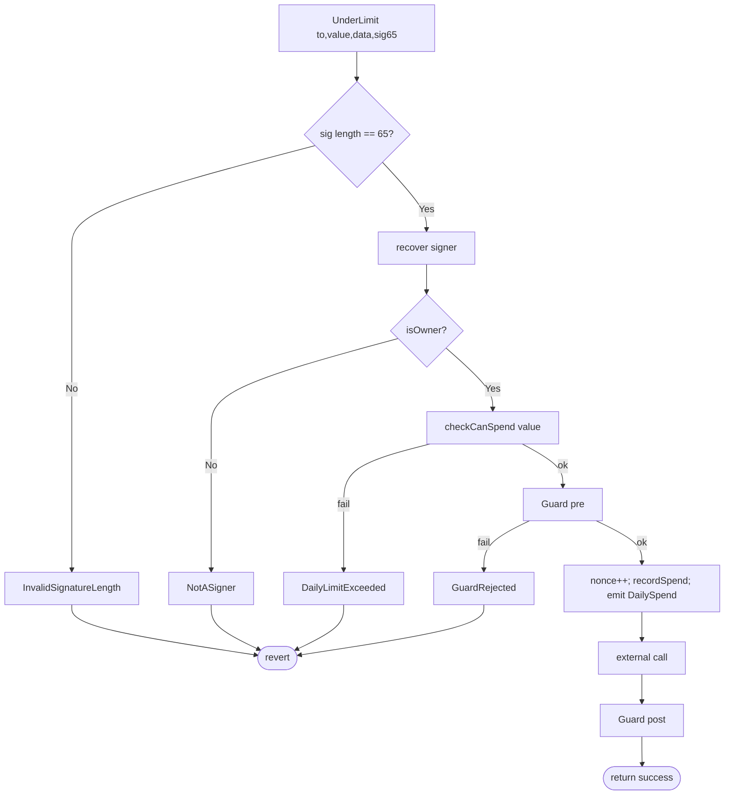
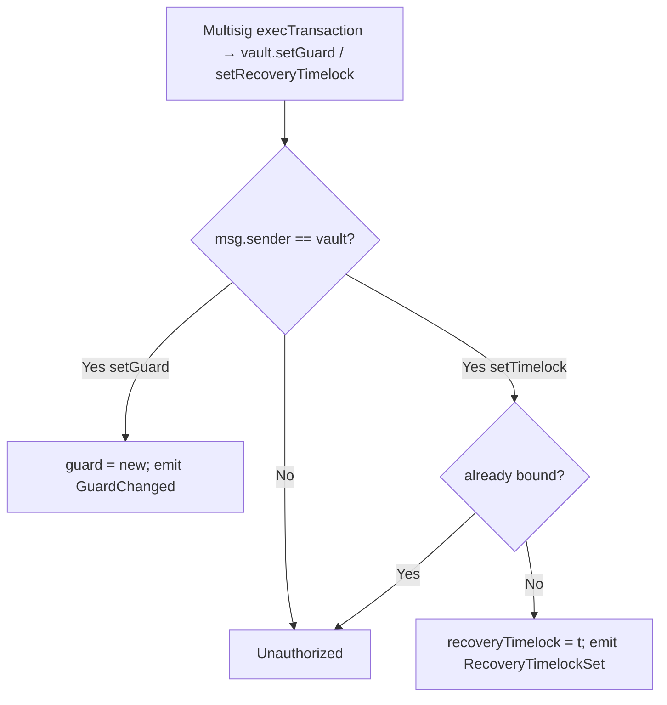
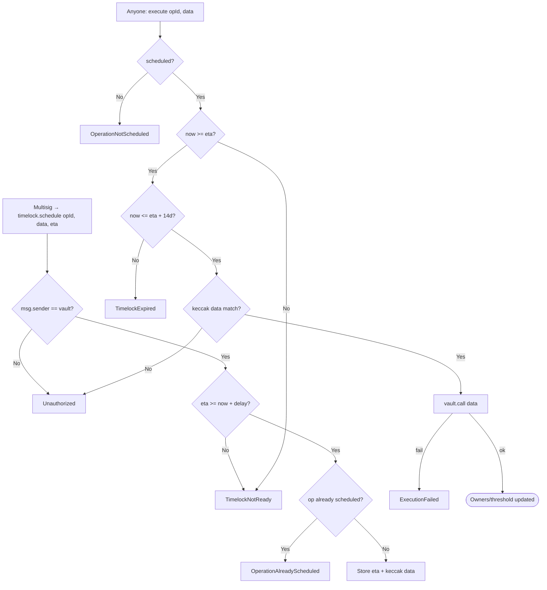

# Flow diagram — Threshold, ERC-1271, spending, guards and recovery

Internal decision flows of the custody protocol (module 20, **v1 implemented**).  
**Sync:** 2026-09-15 · Phases **BOOT → SOLV** ✅ · 69 PASS.

## 1. execTransaction (M-of-N quorum)

> Guard captured **before** the call: a `setGuard` in the same tx does not affect the post-check.

---

## 2. Threshold validation (detail)

> `execTransaction` uses `validateThreshold` (revert). ERC-1271 uses `isValidThreshold` (bool).

---

## 3. ERC-1271 isValidSignature

> Does not revert on the ERC-1271 path (dApp compatibility).

---

## 4. Daily spending — execTransactionUnderLimit

> Only `value` (ETH) counts toward the cap. `value == 0` does not consume allowance. Full quorum bypasses the cap.

---

## 5. setGuard / setRecoveryTimelock

---

## 6. Recovery Timelock — signer / threshold change

> Typical `data`: `addOwnerWithThreshold` / `removeOwnerWithThreshold` / `changeThreshold`.  
> Vault mutations only accept `msg.sender == recoveryTimelock`.
