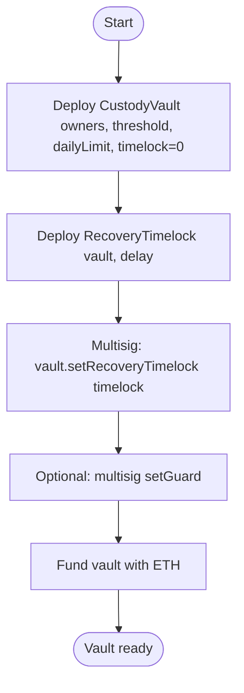
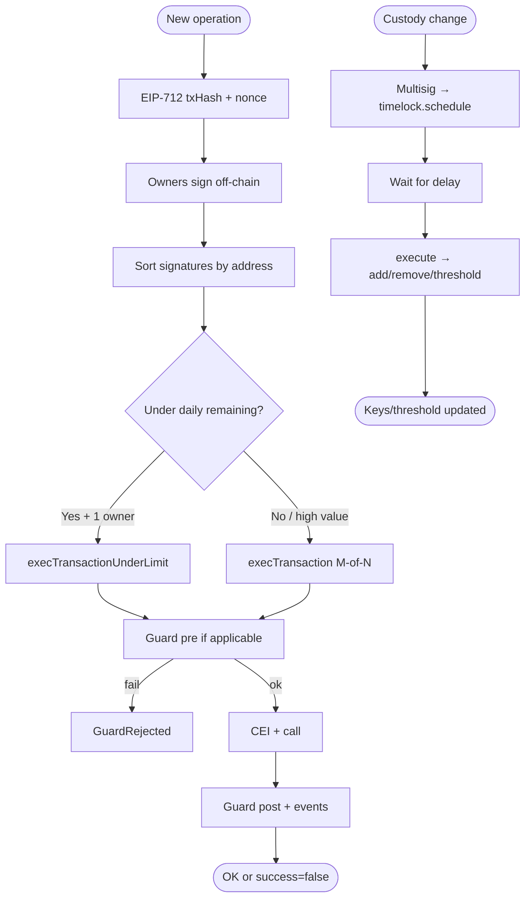
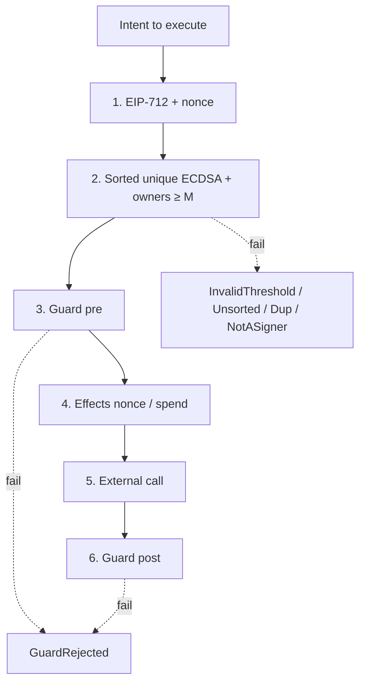
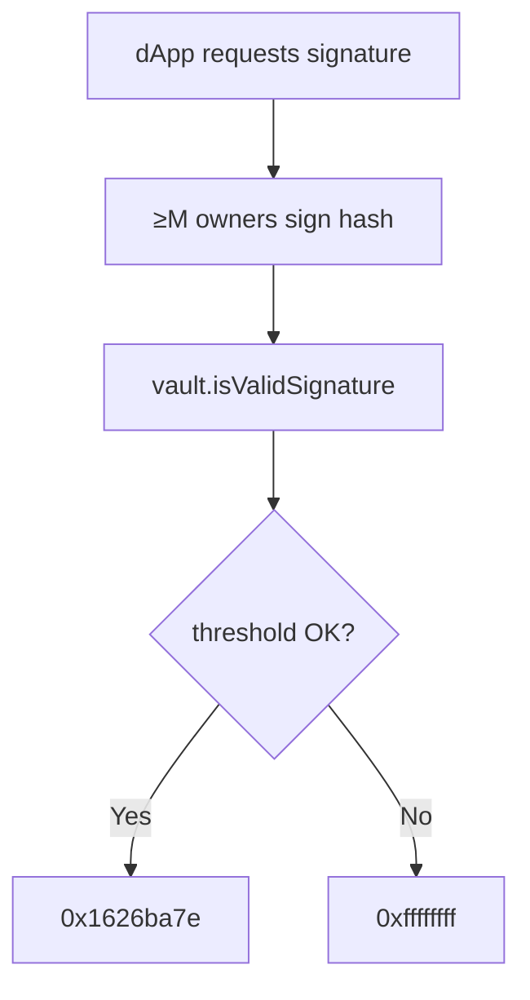
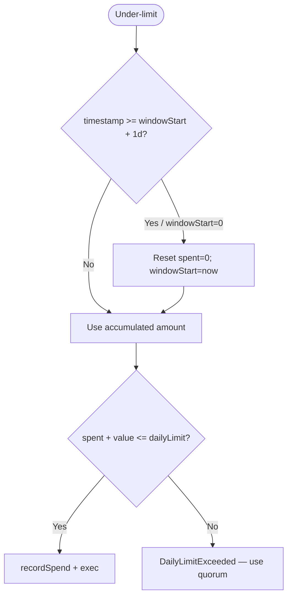
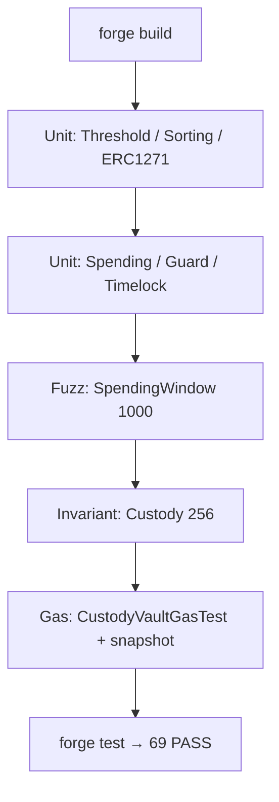

# Flowchart — Full Institutional Custody & Multisig cycle

End-to-end flow (module 20, **v1 implemented**).  
**Sync:** 2026-09-15 · Phases **BOOT → SOLV** ✅ · 69 PASS.

## Actors

| Actor | Role |
|-------|------|
| Institution / Deployer | Deploys vault + timelock; initial owners |
| Owners (N) | Sign off-chain (EOA or MPC shares → ECDSA) |
| Relayer | Submits `execTransaction` / under-limit / `timelock.execute` |
| Under-limit operator | Owner with 1 signature below the daily cap |
| Guard | Pre/post policy (optional) |
| dApp / DeFi | `isValidSignature` (ERC-1271) |
| CI / Foundry | Unit, fuzz, invariants, gas, SWC |

---

## Flowchart — Deploy and wiring (v1)

> Script: `script/Deploy.s.sol` (deploys vault + timelock; manual binding via multisig).  
> Env: `.env.example` (`OWNER_1..3`, `THRESHOLD`, `DAILY_LIMIT`, `TIMELOCK_DELAY`).

---

## Main flowchart — Sign → Execute → Limit → Recovery

---

## Flowchart — Defense layers

---

## Flowchart — ERC-1271 (dApp)

---

## Flowchart — Spending window

---

## Flowchart — Foundry tooling (lab)

---

## Relation to other docs

| Document | Content |
|----------|---------|
| [diagrama-de-clases-EN.md](./diagrama-de-clases-EN.md) | Contracts, interfaces, libraries (real API) |
| [diagrama-de-flujo-EN.md](./diagrama-de-flujo-EN.md) | Internal per-function decisions |
| [planificacion-EN.md](./planificacion-EN.md) | BOOT→SOLV phases closed |
| [SWC-AUDIT-EN.md](./SWC-AUDIT-EN.md) | SWC-100–136 matrix |
| [GAS-EN.md](./GAS-EN.md) | Gas baseline |
